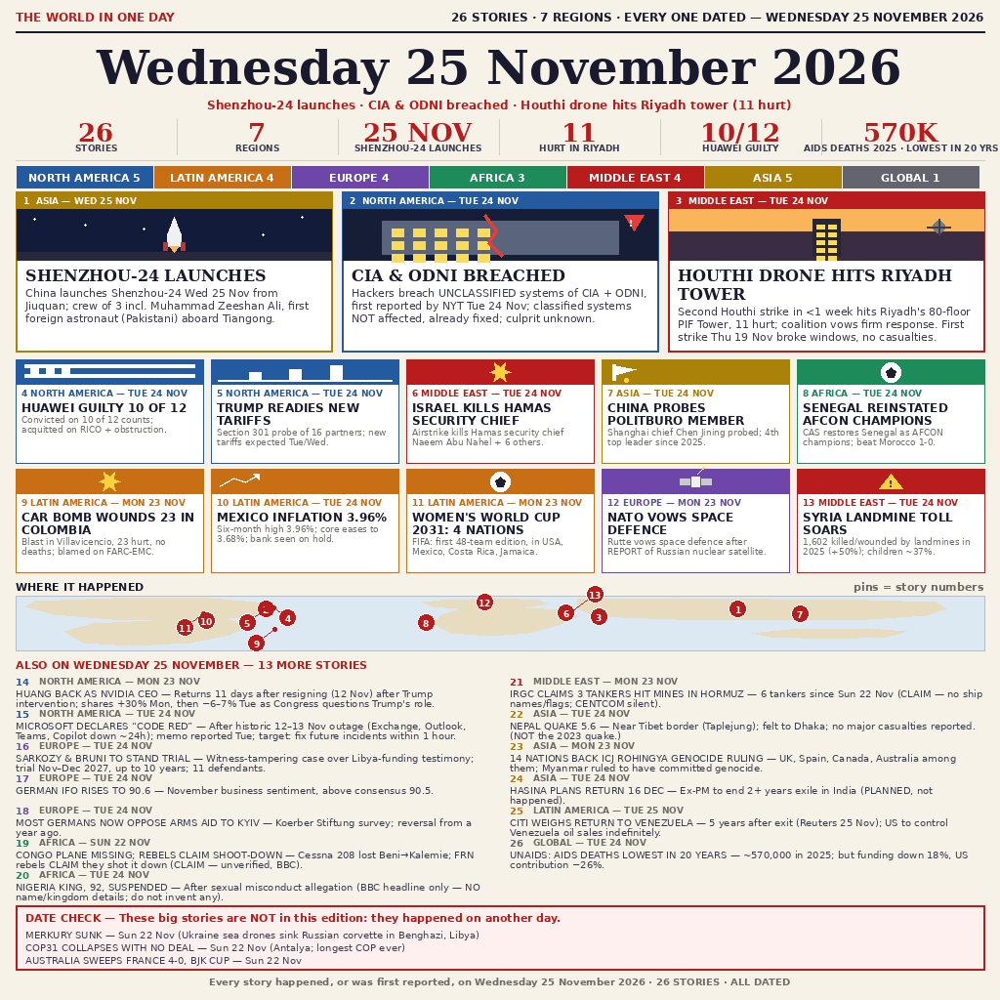

# Wednesday 25 November 2026 — 26 dated stories, 7 regions: Shenzhou-24 launches, CIA breached, Houthi drone hits Riyadh tower

One page that sums up Wednesday 25 November 2026 in a single image: 26 stories
from 7 regions, every one dated. Three illustrated lead stories — Shenzhou-24
launches with the first foreign astronaut aboard Tiangong, hackers breach the
CIA and ODNI's unclassified systems, and a Houthi drone hits Riyadh's tallest
tower — plus 10 illustrated medium stories, a world map with numbered pins,
13 more briefs, and a DATE CHECK box that names the big stories deliberately
left out because they happened on another day.

Every card carries an honest date tag — WED 25 NOV, TUE 24 NOV, MON 23 NOV —
and every claim, report, or plan is labelled as such. Every story here
happened, or was first reported, on Wednesday 25 November 2026, or on the
days just before it as the tag says.

## The 26 stories

### Heroes
1. **[ASIA — WED 25 NOV] SHENZHOU-24 LAUNCHES** — China launches Shenzhou-24 Wed 25 Nov, 08:18 Beijing, Long March-2F from Jiuquan; crew of 3 incl. Muhammad Zeeshan Ali — the first foreign astronaut (Pakistani) aboard Tiangong; 5–10 day stay, 4 biotech experiments. (Reuters, Nature)
2. **[NORTH AMERICA — TUE 24 NOV] CIA & ODNI BREACHED** — Hackers breach UNCLASSIFIED systems of CIA + Office of Director of National Intelligence (OSINT analysis network), first reported by NYT Tue 24 Nov; classified systems NOT affected, already fixed; culprit + exact data stolen unknown; suspected tool "ARTEX". (Reuters, AP)
3. **[MIDDLE EAST — TUE 24 NOV] HOUTHI DRONE HITS RIYADH TOWER** — Second Houthi strike in <1 week hits the 80-floor PIF Tower (Saudi wealth fund HQ, ~$1tn assets), 11 hurt (Saudi Civil Defence); Saudi-led coalition vows firm response. First strike Thu 19 Nov broke windows on 7–8 floors, NO casualties. (Reuters)

### Medium
4. **[NORTH AMERICA — TUE 24 NOV] HUAWEI GUILTY 10 OF 12** — Brooklyn jury convicts Huawei on 10 of 12 counts: bank/wire fraud, sanctions violations, stealing trade secrets (incl. Cisco router code); ACQUITTED on the heaviest charges (RICO + obstruction); sentencing 14 Sep 2027; Huawei to appeal. (Reuters, AP)
5. **[NORTH AMERICA — TUE 24 NOV] TRUMP READIES NEW TARIFFS** — Section 301 probe into excess capacity at 16 trading partners (incl. China + EU); findings + new import tariffs expected Tue/Wed; 62% of Americans back scrapping tariffs (Reuters/Ipsos). (Reuters)
6. **[MIDDLE EAST — TUE 24 NOV] ISRAEL KILLS HAMAS SECURITY CHIEF** — Airstrike kills Naeem Abu Nahel, Hamas internal security director (2 months in post) + 6 others in western Gaza City, amid fragile ceasefire; UNRWA worker killed Mon 23 Nov in Jabalia. (Al Jazeera, BBC)
7. **[ASIA — TUE 24 NOV] CHINA PROBES POLITBURO MEMBER** — Chen Jining, Shanghai party chief, under investigation (Xinhua); 4th member of top leadership body probed since 2025. (Reuters)
8. **[AFRICA — TUE 24 NOV] SENEGAL REINSTATED AFCON CHAMPIONS** — CAS unanimously restores Senegal as 2025 Africa Cup winners, overturning CAF; Senegal beat hosts Morocco 1-0 in Jan 2026 final (Pape Gueye); Morocco to challenge. (Reuters, CNN)
9. **[LATIN AMERICA — MON 23 NOV] CAR BOMB WOUNDS 23 IN COLOMBIA** — Blast outside regional government offices in Villavicencio (Meta dept), 23 hurt, no deaths; 80–100 kg pentolite; blamed on FARC-EMC commander Antonio Medina. (AP, BBC)
10. **[LATIN AMERICA — TUE 24 NOV] MEXICO INFLATION 3.96%** — Six-month high (INEGI); core eases to 3.68%; central bank seen on hold in December. (Reuters)
11. **[LATIN AMERICA — MON 23 NOV] WOMEN'S WORLD CUP 2031: USA, MEXICO, COSTA RICA, JAMAICA** — FIFA: first 48-team edition, first in 4 nations; 2035 to UK & Ireland. (FIFA, CNN)
12. **[EUROPE — MON 23 NOV] NATO VOWS SPACE DEFENCE** — Sec-Gen Rutte after Western intel REPORT that Russia assembled nuclear-armed "Sputnik-S" satellite, launchable within 60 days — REPORT, Kremlin denies; Germany's Merz calls it "shocking". (BBC, Fox News)
13. **[MIDDLE EAST — TUE 24 NOV] SYRIA LANDMINE TOLL SOARS** — 1,602 killed/wounded by landmines in 2025 (+50%); children ~37%; only Myanmar higher (1,891). (BBC, UN News)

### Briefs
14. **[NORTH AMERICA — MON 23 NOV] HUANG BACK AS NVIDIA CEO** — Returns 11 days after resigning (12 Nov) after Trump intervention; shares +30% Mon, then −6–7% Tue as Congress questions Trump's role.
15. **[NORTH AMERICA — TUE 24 NOV] MICROSOFT DECLARES "CODE RED"** — After historic 12–13 Nov outage (Exchange, Outlook, Teams, Copilot down ~24h); internal memo reported Tue; new target: fix future incidents within 1 hour.
16. **[EUROPE — TUE 24 NOV] SARKOZY & BRUNI TO STAND TRIAL** — Witness-tampering case over Libya-funding testimony; trial Nov–Dec 2027, up to 10 years; 11 defendants.
17. **[EUROPE — TUE 24 NOV] GERMAN IFO RISES TO 90.6** — November business sentiment, above consensus 90.5. (Reuters)
18. **[EUROPE — TUE 24 NOV] MOST GERMANS NOW OPPOSE ARMS AID TO KYIV** — Koerber Stiftung survey; reversal from a year ago. (Reuters)
19. **[AFRICA — SUN 22 NOV, reported TUE 24 NOV] CONGO PLANE MISSING; REBELS CLAIM SHOOT-DOWN** — Cessna 208 lost Beni→Kalemie; FRN rebels CLAIM they shot it down (CLAIM — unverified, BBC).
20. **[AFRICA — TUE 24 NOV] NIGERIA KING, 92, SUSPENDED** — After sexual misconduct allegation (BBC headline only — no name or kingdom details).
21. **[MIDDLE EAST — MON 23 NOV] IRGC CLAIMS 3 TANKERS HIT MINES IN HORMUZ** — 6 tankers since Sun 22 Nov (CLAIM — no ship names/flags; CENTCOM silent).
22. **[ASIA — TUE 24 NOV] NEPAL QUAKE 5.6** — Near Tibet border (Taplejung); felt to Dhaka; no major casualties reported. (NOT the 2023 quake.)
23. **[ASIA — MON 23 NOV] 14 NATIONS BACK ICJ ROHINGYA GENOCIDE RULING** — UK, Spain, Canada, Australia among them; Myanmar ruled to have committed genocide.
24. **[ASIA — TUE 24 NOV] HASINA PLANS RETURN 16 DEC** — Ex-PM to end 2+ years exile in India (PLANNED, not happened).
25. **[LATIN AMERICA — TUE 25 NOV] CITI WEIGHS RETURN TO VENEZUELA** — 5 years after exit (Reuters 25 Nov); US to control Venezuela oil sales indefinitely.
26. **[GLOBAL — TUE 24 NOV] UNAIDS: AIDS DEATHS LOWEST IN 20 YEARS** — ~570,000 in 2025; but funding down 18%, US contribution −26%. (Reuters)

## DATE CHECK — these big stories are NOT in this edition: they happened on another day
- MERKURY SUNK — Sun 22 Nov (Ukraine sea drones sink Russian corvette in Benghazi, Libya)
- COP31 COLLAPSES WITH NO DEAL — Sun 22 Nov (Antalya; longest COP ever)
- AUSTRALIA SWEEPS FRANCE 4-0, BJK CUP — Sun 22 Nov

## How it runs
`main.py` is standard library only. It decodes the embedded base64 PNG,
validates it (PNG signature, IHDR exactly 1024x1024, 8-bit palette, CRC of
every chunk, no trailing data after IEND, ≤1 MiB), and writes it byte-for-byte.
Run it with `MAKEFUN_OUTPUT_DIR=out python3 main.py`, pass an output path as
the first argument, or pipe the PNG from stdout.
